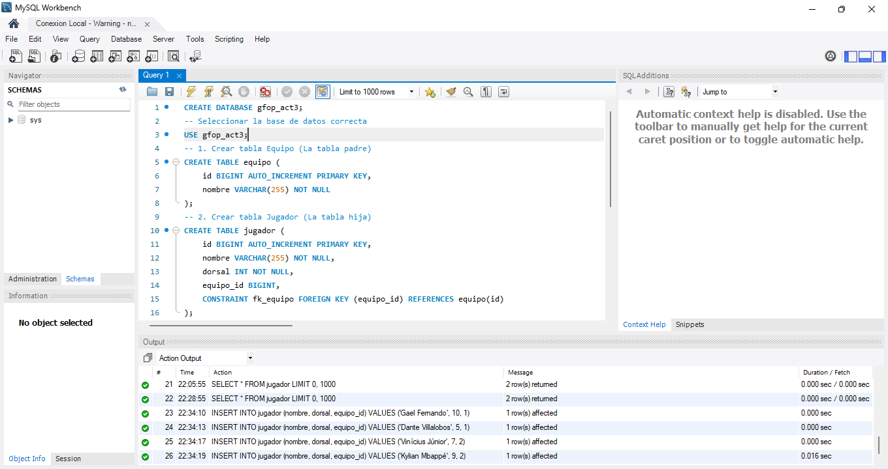
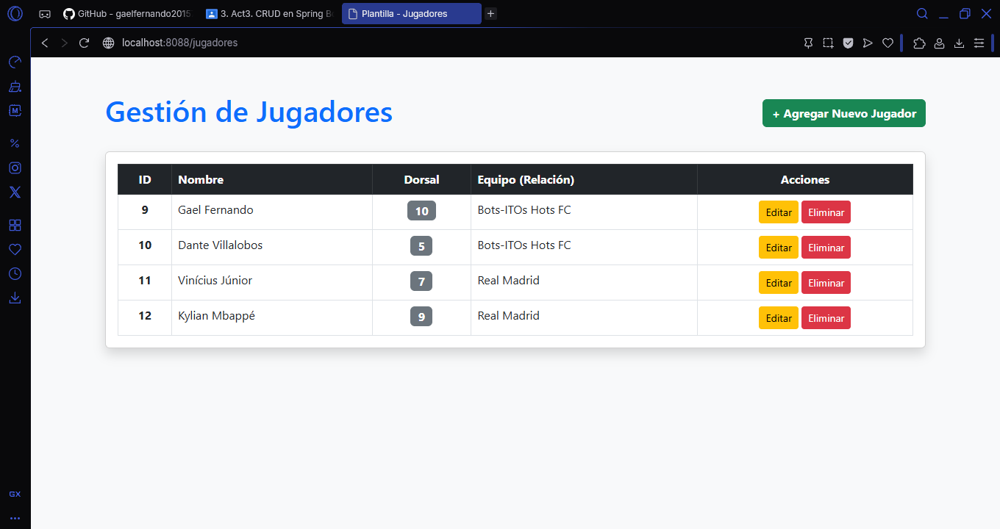
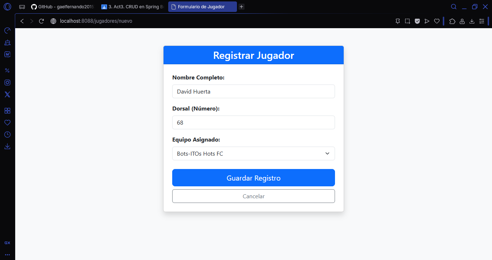
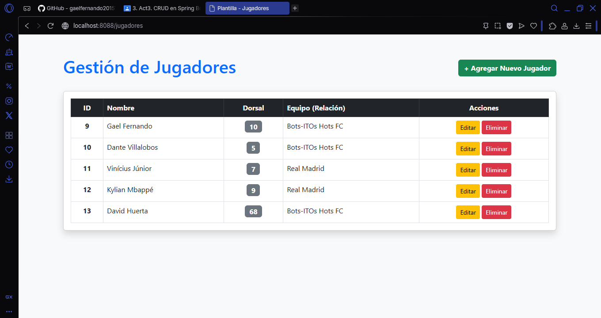
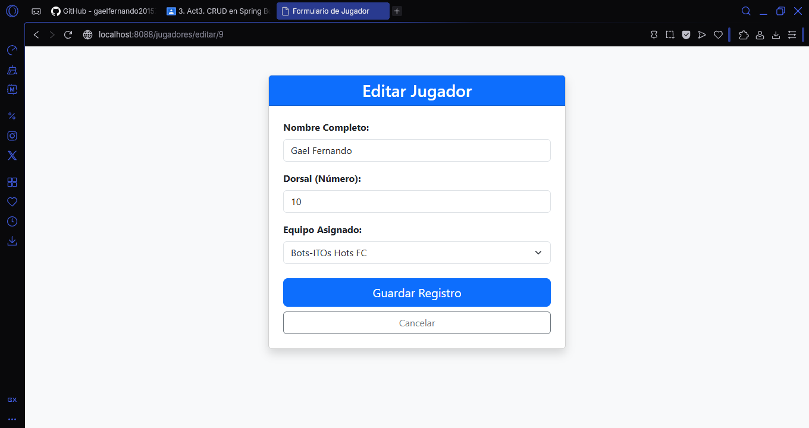
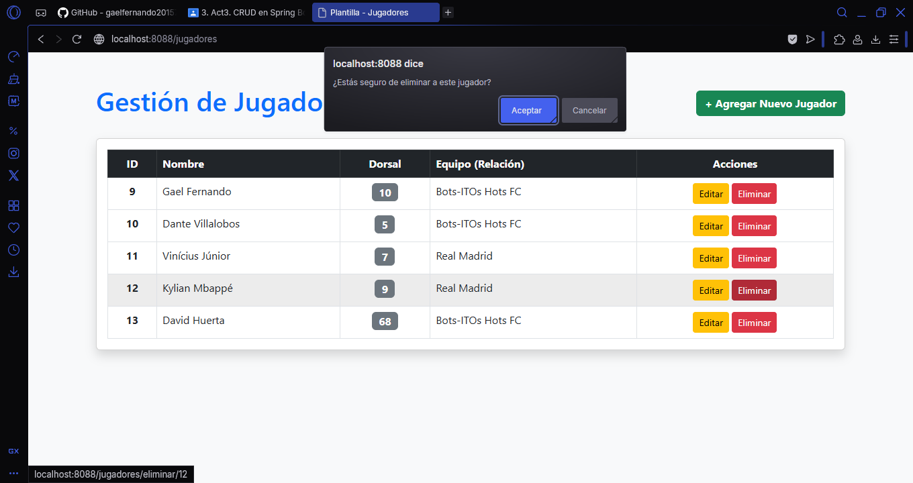
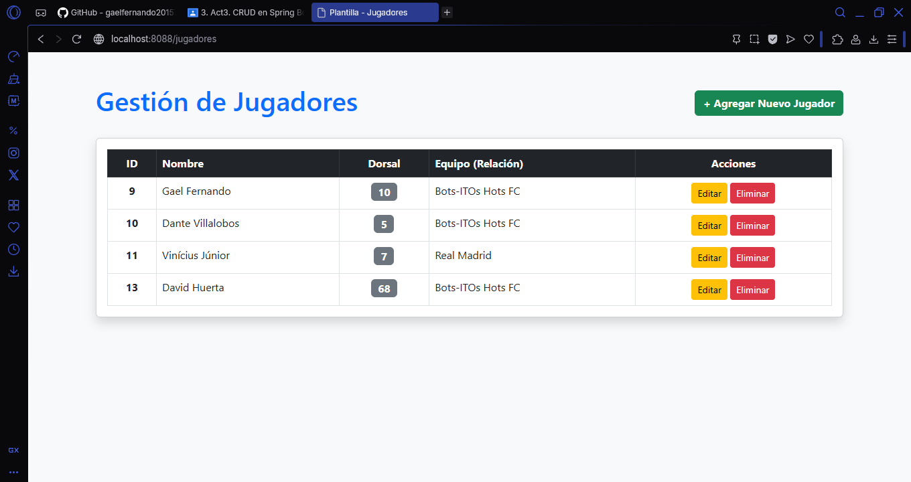

# Actividad 3: CRUD en Spring Boot y Relaciones JPA

**Alumno:** Gael Fernando Ortiz Pérez  
**Materia:** Programación Web
**Grupo:** 7SD
**Proyecto:** GFOPact3_t4

## Objetivo del Proyecto

Construcción de un CRUD completo en Spring Boot conectado a una base de datos real (MySQL), implementando una relación bidireccional entre entidades y utilizando vistas de Thymeleaf integradas en el mismo proyecto. El proyecto se encuentra desplegado en un servidor VPS remoto (Puerto 8088).

---

## Entidades y Relación Implementada

Para este proyecto, se eligió una temática deportiva gestionando **Jugadores** y **Equipos**.
Se implementó una relación relacional mediante JPA:

- **Equipo (Uno):** Entidad padre. Tiene una relación `@OneToMany` hacia Jugador.
- **Jugador (Muchos):** Entidad hija. Tiene una relación `@ManyToOne` hacia Equipo, generando la llave foránea `equipo_id` en la base de datos.

---

## Evidencias de Funcionamiento (Operaciones CRUD)

A continuación, se demuestra el funcionamiento completo del CRUD persistiendo datos en MySQL y reflejando la relación entre tablas.

### 1. Entidades Relacionadas en Base de Datos

_Muestra la estructura de la base de datos o los registros en MySQL Workbench donde se aprecia la llave foránea `equipo_id`._

### 2. Leer (Read) - Relación Reflejada

_Muestra la vista de la tabla (lista.html) donde se listan los jugadores. Se comprueba que la relación funciona porque en la columna "Equipo" se renderiza el **nombre** del equipo (ej. "Bots-ITOs Hots FC") y no solamente su ID._

### 3. Crear (Create)

_Muestra el formulario (formulario.html) al agregar un nuevo jugador, demostrando que el `<select>` carga los equipos disponibles desde la base de datos._

### 4. Actualizar (Update)

_Muestra el formulario cargando los datos existentes de un jugador específico para ser editados._

### 5. Eliminar (Delete)

_Muestra la alerta de confirmación o la lista de jugadores actualizada después de haber eliminado un registro exitosamente._

---

## Tecnologías y Arquitectura Utilizada

- **Framework Backend:** Spring Boot 3
- **Persistencia:** Spring Data JPA / Hibernate
- **Base de Datos:** MySQL
- **Motor de Plantillas:** Thymeleaf
- **Diseño UI:** Bootstrap 5 (CDN)
- **Arquitectura:** Patrón multicapa (Entity -> Repository -> Service -> Controller)

## Despliegue en VPS

El proyecto está compilado en un archivo `.jar` y se ejecuta de forma independiente en un servidor VPS con Ubuntu, apuntando a un motor MySQL productivo, operando en el puerto designado:

- **URL de acceso:** `http://143.198.182.173:8088/jugadores`
